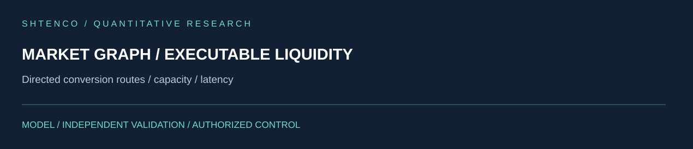
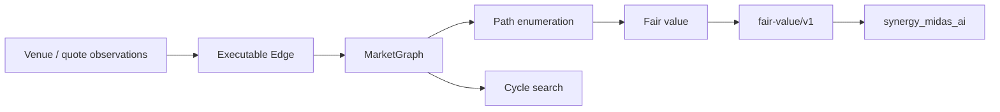

<!-- SCIENTIFIC-V4-2026:START -->


[Научно-техническое досье V4](docs/SCIENTIFIC_DOSSIER_V4_2026.md) — математическая модель, архитектура, эксперименты. Исходный README ниже сохранён полностью.
<!-- SCIENTIFIC-V4-2026:END -->

#  SYNERGY Market Graph — verified technical dossier

> **Статус:**  CANDIDATE — executable graph model, typed fair-value contract, enterprise API and tests exist.
> **Проверено по `main`:** 29.09.2026.

## 1.  Задача

`synergy_market_graph` представляет рынок как направленный graph executable conversion edges и вычисляет multi-path fair value после fees/slippage.

Ключевая задача — отделить:

```text
quoted rate
!=
executable rate
!=
multi-path fair value
!=
guaranteed arbitrage
```

## 2.  Фактический состав

Repository содержит Python package, enterprise layer, tests, Dockerfile, deployment/loadtest scaffolding, docs/examples и federation contract.

Ключевые файлы:

```text
src/synergy_market_graph/core.py
src/synergy_market_graph/api.py
src/synergy_market_graph/synergy_contracts.py
tests/test_enterprise_product.py
...```

## 3.  Core data model

`Edge` содержит:

- src/dst;
- rate;
- fee_bps;
- capacity;
- slippage_bps;
- latency_ms;
- venue.

Executable rate:

[
r_{exec}
=
r
left(
1-rac{fee_{bps}+slippage_{bps}}{10000}

ight)
]

Нулевая/отрицательная raw rate запрещена.

## 4.  MarketGraph

`MarketGraph` реализует:

- adjacency structure;
- path enumeration до `max_hops`;
- path executable rate;
- fair value;
- cycle search.

Path rate:

[
R_p=prod_{e in p}r_{exec,e}
]

Fair value текущей реализации — геометрическое среднее executable rates найденных путей:

[
FV =
exp
left(
rac{1}{N}
sum_{p=1}^N ln R_p

ight)
]

Это конкретная implemented definition; она не выдаётся за универсальный market microstructure estimator.

## 5.  Cycle analysis

Для cycle back to start:

[
edge_{bps}=(R_{cycle}-1)	imes10000
]

Cycles сортируются по рассчитанному edge descending.

Критическая граница: рассчитанный cycle edge ещё не означает executable profit, если capacity, latency, stale quotes, leg risk или venue constraints не смоделированы полностью.

## 6.  Архитектура



## 7.  Federation contract

```text
CONTRACT_ID = synergy.trading.fair-value/v1
AUTHORITY   = market_graph
```

`fair_value_payload(...)`:

- требует `observation_id`;
- строит graph из edge dictionaries;
- считает fair value;
- reject если executable path отсутствует;
- возвращает `authorization=false`.

## 8.  Inputs

- observation id;
- src/dst assets;
- edge list;
- rates;
- fees;
- slippage;
- optional capacity/latency/venue;
- max hops.

## 9.  Outputs

- src/dst;
- fair value;
- max hops;
- observation id;
- `authorization=false`.

Enterprise API дополнительно может возвращать cycle analysis и request correlation.

## 10.  Invariants

```text
raw quote       != executable quote
fair value      != order authorization
cycle edge      != realized arbitrage P&L
negative rate   -> reject
no path         -> reject
graph output    requires timestamp/provenance downstream
```

## 11.  Реальные tests

`test_enterprise_product.py` строит fixture:

- USD→EUR;
- USD→GBP;
- GBP→EUR;
- EUR→USD;

и вызывает:

```text
POST /enterprise/v1/graph/analyze
```

Тест проверяет:

- response 200 для authorized `researcher`;
- наличие `fair_value`, `cycles`, `request_id`;
- audit linkage по request id;
- `viewer` получает 403;
- enterprise routes присутствуют.

В repo также есть tests для core, adapters, deployment, foundation, service, release metadata и SYNERGY contracts.

## 12.  Modeling limits

Текущая `fair_value()`:

- не weight'ит paths по liquidity/capacity;
- не устраняет correlated/overlapping paths;
- не моделирует asynchronous quote time;
- не применяет execution sequencing;
- не гарантирует simultaneous fills.

`capacity` и `latency_ms` находятся в Edge model, но core fair-value formula их напрямую не использует.

Это нужно явно учитывать при downstream interpretation.

## 13.  Required next tests

- stale-edge timestamps;
- capacity-bound path rate;
- partial fill;
- latency-dependent cycle failure;
- duplicated path sensitivity;
- venue disconnect;
- negative/zero executable rate after costs;
- graph explosion / max-hop bounds;
- deterministic fixture baselines.

## 14.  Воспроизводимость

```bash
git clone https://github.com/Shtenco/synergy_market_graph.git
cd synergy_market_graph
python -m pip install -e .
pytest -q
```

Наличие deploy/container assets не означает production runtime без observed deployment evidence.

## 15.  Карта repository

| Path | Role |
|---|---|
| `src/.../core.py` | graph/path/fair-value/cycle math |
| `src/.../synergy_contracts.py` | fair-value/v1 payload |
| `src/.../api.py` | API surface |
| `src/.../enterprise/` | auth/audit enterprise controls |
| `tests/` | core/product/service/deployment tests |
| `Dockerfile` | container build |
| `deploy/` | deployment assets |
| `loadtests/` | load testing |

## 16.  Место в SYNERGY

Producer:

```text
synergy_market_graph
  -> synergy.trading.fair-value/v1
  -> synergy_midas_ai
```

Это market evidence producer, не execution authority.

## 17.  Evidence maturity

| Layer | Status |
|---|---|
| executable graph math |  |
| fees/slippage in edge rate |  |
| path/cycle search |  |
| federation contract |  |
| enterprise tests |  source |
| timestamp provenance | incomplete |
| capacity-aware fair value | incomplete |
| cross-repo observed E2E |  |
| realized arbitrage proof |  |

## 18.  Roadmap

1. timestamp/provenance per edge;
2. liquidity/capacity weighting;
3. latency-aware executable graph;
4. venue sequencing;
5. robust fair-value alternatives;
6. strict historical replay;
7. observed M4 federation evidence.

## 19.  Что проект НЕ утверждает

- что geometric multi-path mean — «истинная цена»;
- что найденный cycle исполним;
- что graph edge гарантирует profit;
- что API output разрешает сделку;
- что source tests = production evidence.

## 20.  Sensitivity and falsification checklist

A graph fair-value engine can look impressive while being structurally fragile. The following checks should be mandatory before using its output downstream:

### Path duplication sensitivity

If the same economic route is represented twice through duplicated edges, the geometric mean can shift even though the market has not changed. The benchmark should therefore compare:

```text
original graph
vs
graph with duplicated economically-equivalent path
```

and quantify fair-value drift.

### Capacity sensitivity

Two paths with the same rate but radically different executable capacity should not necessarily receive equal influence in a production fair-value estimator.

Future variants should report both:

- current unweighted geometric fair value;
- capacity/liquidity-weighted alternative.

### Timestamp sensitivity

Every edge needs:

```text
observed_at
source
venue
sequence/version
```

A cross-venue cycle built from stale edges must be marked invalid even if arithmetic edge is positive.

### Cost stress

For each candidate graph snapshot, recompute under:

```text
fees × {1, 1.5, 2}
slippage × {1, 2, 4}
latency penalty scenarios
```

If a claimed edge disappears under tiny perturbations, it is research-only.

## 21.  Minimum evidence bundle for one fair-value observation

A strong artifact should contain:

```json
{
  "observation_id": "...",
  "captured_at": "...",
  "src": "USD",
  "dst": "EUR",
  "edges_sha256": "...",
  "max_hops": 3,
  "path_count": 2,
  "fair_value": 0.0,
  "method": "geometric_mean_executable_path_rates",
  "software_commit": "...",
  "authorization": false
}
```

Plus the raw edge snapshot. Without raw inputs, the fair value cannot be independently recalculated.

## 22.  Promotion gate

Before this repository may be described as an executable institutional market graph, require simultaneously:

- timestamped real/saved venue observations;
- deterministic replay;
- capacity-aware route tests;
- cost sensitivity;
- stale-quote rejection;
- graph-size/performance benchmark;
- observed contract consumer in MIDAS;
- machine-readable evidence persisted with hashes.

Until then the current code is a strong **graph research/feature producer**, not execution truth.

---

[ SYNERGY SYSTEM](https://github.com/Shtenco/synergy_system) · [ Atlas](https://github.com/Shtenco/synergy_system/blob/main/docs/SYNERGY_REPOSITORY_ATLAS.md)
