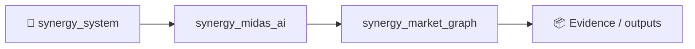
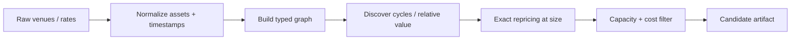

# SYNERGY Market Graph

> **Graph fair value, executable-cycle discovery and causal/relative-value market representation**

Version: `2.0.0`

**Enterprise v2.0.0** · Python 3.11+ · FastAPI/OpenAPI · Docker/Compose · RBAC/JWT · PostgreSQL/ClickHouse audit

**Designed for:** Market makers, FX/crypto quant desks, exchanges and liquidity providers  
**Primary endpoint:** `POST /enterprise/v1/graph/analyze`

> [!IMPORTANT]
> Graph-derived fair value/cycles are research evidence. They do not guarantee executable arbitrage, fills or profit.

## Institutional package
Deterministic graph core · tenant RBAC · request-ID audit · health/metrics · Docker/Compose · demo/load harnesses · customer pilot documentation.

## Verification
**20 tests passed** · health smoke **80/80 200** · local p95 **87.7 ms** (~526 req/s). Health smoke only.

## Quick start
```bash
pip install -e '.[dev,enterprise]'
pytest -q
python -m synergy_market_graph.api
```

## CTO package
[Due diligence](docs/CTO_DUE_DILIGENCE.md) · [Architecture](docs/ARCHITECTURE_DIAGRAMS.md) · [API](docs/API_EXAMPLES.md) · [Security](SECURITY.md) · [Benchmarks](docs/BENCHMARKS_AND_ACCEPTANCE.md) · [SLA/SLO](docs/SLA_SLO.md) · [Deployment](docs/DEPLOYMENT_CHECKLIST.md) · [Pilot](docs/CUSTOMER_PILOT.md)


<!-- SYNERGY-FEDERATION-PASSPORT:START -->
---

## 🧭 SYNERGY federation passport

**Домен:** 🕸️ Market graph  
**Архитектурный родитель:** [`synergy_midas_ai`](https://github.com/Shtenco/synergy_midas_ai)  
**Архитектурный корень:** [`synergy_system`](https://github.com/Shtenco/synergy_system)



### Документационный контракт

README должен показывать: проблему → архитектуру → реальные артефакты → проверку → ограничения → связи с федерацией. Сильные claims без evidence остаются R&D/CANDIDATE.

### Навигация

- [📚 Атлас всех 75 репозиториев](https://github.com/Shtenco/synergy_system/blob/main/docs/SYNERGY_REPOSITORY_ATLAS.md)
- [🧾 Машиночитаемый registry](https://github.com/Shtenco/synergy_system/blob/main/registry/SYNERGY_REPOSITORIES.json)
- [🧭 SYNERGY SYSTEM](https://github.com/Shtenco/synergy_system)

### Authority rule

Репозиторий не присваивает полномочия соседнего домена: AI ≠ authorization, UI ≠ ledger, blockchain commitment ≠ accounting truth, backtest ≠ realized external P&L.

<!-- SYNERGY-FEDERATION-PASSPORT:END -->
---

# 🕸️ Глубокая техническая спецификация Market Graph

## 🎯 Проблема

Арифметический цикл или graph fair value не равен исполнимому арбитражу. Нужен граф, где ребро содержит цену, объём, стоимость, latency, settlement и evidence.

## 🏗️ Pipeline



## 📥 Входы

- quotes/order books;
- symbol mapping;
- fees;
- capacity/depth;
- latency/settlement;
- timestamps;

## 📤 Выходы

- typed graph snapshot;
- fair-value relations;
- cycle candidates;
- capacity-limited route;
- evidence-backed repricing;

## 🛡️ Непереговорные инварианты

```text
AlphaGraph != RebalancingGraph
no stale edge in executable route
cycle profit must be net of all modeled costs
shared edge capacity cannot be double-used
candidate != executed arbitrage
```

## 🧪 Как ловить ложный GREEN

- отделять API/health benchmark от качества торгового решения;
- проверять stale-state и timestamp binding;
- иметь negative/adversarial tests;
- не считать unit-test coverage доказательством инвестиционной ценности;
- сохранять request → decision → downstream evidence chain;
- явно указывать, что измерено локально, а что требует customer/live validation.

## 🔗 Контракт с соседями

- [`synergy_algotrading_graph_system`](https://github.com/Shtenco/synergy_algotrading_graph_system)
- [`synergy_relative_value`](https://github.com/Shtenco/synergy_relative_value)
- [`synergy_trademux`](https://github.com/Shtenco/synergy_trademux)
- [`synergy_pay_system`](https://github.com/Shtenco/synergy_pay_system)

## 🚀 Следующий доказательный рубеж

1. frozen acceptance dataset;
2. adversarial fixtures;
3. cross-module typed contract;
4. end-to-end trace id;
5. OOS/shadow evidence where market quality is claimed;
6. explicit failure-mode table;
7. reproducible evidence bundle referenced from README.
