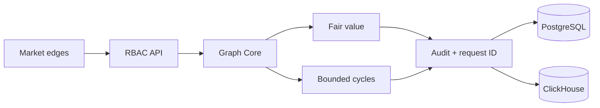

# Architecture — SYNERGY Market Graph

Primary endpoint: `/enterprise/v1/graph/analyze`. Cycle discovery remains research evidence until executable constraints, settlement and venue state are independently verified.